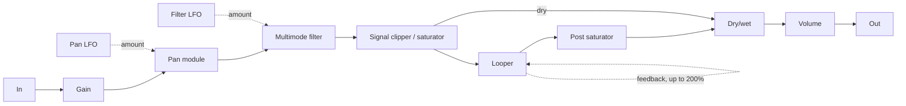

# LoopTexturer

Specification of the signal chain and UI. **Requirement** marks what has been decided, and **Proposed** marks suggestions that aren't confirmed.

**Status:** everything below is implemented, using the proposed values.

LoopTexturer is mainly a sound design tool rather than a performance tool, so some latency is acceptable.

## Signal path

All signals are stereo.

1. In
2. Gain
3. Pan module, modulated by its own LFO
4. Multimode filter, modulated by its own LFO
5. Signal clipper / saturator
6. Looper, with its own feedback path
7. Post saturator, on the looper's output
8. Dry/wet, mixing the signal before the looper with the output of the post saturator
9. Volume
10. Out

## Modules

### Gain

**Requirement:** a gain control at the start of the chain.

**Proposed:** -24 dB to +24 dB, default 0 dB. It also sets how hard the signal hits the saturator.

### Pan module

**Requirement:**

- A pan control.
- Its own LFO, from 0.1 Hz to 10 Hz, mapped to pan.
- An adjustable modulation amount.

**Proposed:**

- Equal-power stereo balance, since the input is already stereo.
- LFO waveforms: sine, triangle, square, sample and hold.

### Multimode filter

**Requirement:**

- A filter with several modes and a frequency control.
- Its own LFO, from 0.1 Hz to 10 Hz, mapped to frequency.
- An adjustable modulation amount.

**Proposed:**

- Modes: low-pass, high-pass, band-pass, notch.
- Frequency from 20 Hz to 20 kHz, plus a resonance control.
- A state-variable filter, which stays stable when the frequency is modulated quickly.
- Modulation amount in octaves, up to ±4, so that sweeps sound even across the range.
- The same LFO waveforms as the pan module.

### Signal clipper / saturator

**Requirement:** several modes, including hard clipping, soft saturation and sine clipping. Other types can be added.

**Proposed modes:**

| Mode | Behaviour | Character |
| --- | --- | --- |
| Hard clip | Flat limit at the ceiling | Bright, aggressive |
| Soft saturator | `tanh` curve | Smooth, warm |
| Sine clip | Follows a sine curve up to its peak, then stays flat | Rounder than hard clip |
| Tube | Asymmetric soft curve | Adds even harmonics |
| Wavefolder | Folds peaks back instead of limiting them | Metallic, gets richer with drive |
| Rectifier | Blends in the absolute value of the signal | Hollow, octave-up |

**Proposed controls and processing:**

- Mode, drive and dry/wet mix.
- 4x oversampling to reduce aliasing, with the resulting latency reported to Cubase.
- A DC blocker, because the Tube and Rectifier modes shift the signal off centre.

### Looper

**Requirement, in both modes:**

- A stereo buffer whose size in samples depends on the sample rate.
- A switch between free running and tempo sync.
- Overdubbing can start at any moment.
- Older layers don't fade in normal operation.
- A feedback control, up to 200%.
- A dry/wet control.
- The loop is saved with the Cubase project.

#### Free running mode

**Requirement:**

- Behaves like a looped magnetic tape recorder running endlessly, whether or not the Cubase transport is running.
- A knob sets the loop length, from 500 ms to 30 s.
- Changing the length repitches the loop, like changing the tape speed.
- Rec and overdub aren't tied to any grid.
- Rec replaces what's on the tape for one whole pass, then moves on to overdubbing. Pressing Rec before the pass ends stops recording instead.
- Stop halts the tape, and Play relaunches it from the start of the loop.

**Proposed:**

- A fixed 30 s buffer acting as the tape (11.52 MB at 48 kHz, which is also what a saved loop adds to a project). The knob sets the tape speed: 30 s is normal speed and 500 ms is 60x.
- A loop saved by version 1.0.0 keeps its 10 s tape and its pitch. The next recording after clearing it gets a 30 s tape.
- Audio recorded at any length plays back at the correct pitch while the knob stays there. Moving the knob across its whole range shifts the pitch by up to about 5.9 octaves.
- On an empty tape, the loop starts where the recording starts.
- Stop leaves the tape standing still, so feedback doesn't change it. Pressing Rec or Overdub on a stopped tape starts it again from the top of the loop.

#### Tempo sync mode

**Requirement:**

- Follows the Cubase transport: the loop stops with the transport and resumes in the right position.
- Loop lengths in bars, from presets (1/2, 1, 2, 6, 8 bars and so on) or an arbitrary number of bars.
- Two ways to end recording: a chosen length stops by itself, and an open-ended setting records until Rec is pressed again, closing the loop at the next bar line.
- Maximum of 64 bars. If recording reaches this length, the loop ends and replay starts.
- However a recording ends, the looper moves on to overdubbing.
- Rec and Play start at the next bar line, so the loop stays matched to the grid.
- A tempo change repitches the loop.

**Proposed:**

- Length presets of 1/2, 1, 2, 4, 6 and 8 bars, plus any whole number of bars up to 64.
- Bar length taken from Cubase's tempo and time signature when recording starts. After that, the loop keeps its length in beats if the time signature changes.
- Playback stays in phase with where the loop was recorded: a 2-bar loop recorded from bar 5 always restarts on odd bars.
- Pressing Rec while the transport is stopped arms recording until playback starts.
- The length setting applies to the next recording, and doesn't change a loop that's already recorded.
- Pressing Rec during a recording ends it at the next bar line, whatever length was chosen.
- Pressing Rec with a loop playing keeps it playing until the next bar line, where the new recording replaces it.
- Stop silences the loop right away. Play brings it back at the next bar line, in phase.
- A locate or cycle jump during the first pass of a recording cancels it, because the loop's length isn't settled yet. Once the loop exists, jumps are fine: it plays from the matching position.

Memory needed for 64 bars of stereo 32-bit audio at 48 kHz in 4/4:

| Tempo | Duration | Memory |
| --- | --- | --- |
| 120 BPM | 128 s | 49 MB |
| 60 BPM | 256 s | 98 MB |
| 30 BPM | 512 s | 197 MB |

#### Feedback

**Requirement:**

- Range up to 200%, for experimenting with distorting loops.
- Doesn't change the loop in normal operation, so the default is 100%.
- Scoped to the looper: the feedback path doesn't pass through the post saturator.

**Proposed:**

- Feedback is applied on every pass while the loop plays, not only while overdubbing. So anything other than 100% keeps changing the loop for as long as it runs.
- A soft saturating limiter, unchanged up to full scale and with a ceiling of 1.5 (+3.5 dB), plus a DC blocker above 100%. At 200% the level doubles on every pass, so it would otherwise run out of control very quickly. This curve is what gives feedback above 100% its distortion.
- At 100%, the loop stays bit-exact over any number of passes, as the audio isn't rewritten.

#### Switching modes

**Requirement:** switching between free running and tempo sync clears the loop, after asking for confirmation.

### Post saturator

**Requirement:**

- A second saturation module on the looper's output, before the dry/wet control.
- For colouring and destructive sound design. It doesn't change the loop's contents, because the feedback path doesn't pass through it.

**Proposed:** the same modes, controls and processing as the first saturator, bypassed by default.

### Dry/wet

**Requirement:** a dry/wet control, used instead of a monitoring switch to set how much of the live input you hear alongside the loop.

**Proposed:** the dry signal stays at full level up to the 50% position and the wet signal reaches full level there, with 50% as the default. This way, nothing drops in level when the loop is empty. Recording always takes the signal from before this control.

### Volume

**Requirement:** a volume control at the end of the chain.

**Proposed:** from silence to +6 dB, default 0 dB.

## Drag to timeline

**Requirement:**

- Drag the looper's audio from the plug-in onto the Cubase timeline, like the Looper in Ableton Live.
- On Linux, there's no dragging. VSTGUI can't start a drag there, and a host can render or record the output instead.
- The WAV contains the loop as heard: at its current speed and through the post saturator, without the dry signal or Volume.

VST3 has no API for this. The plug-in writes a WAV file and starts an operating system file drag, which works in Cubase. Dragging starts from the waveform.

**Proposed:** 32-bit float files with unique names, kept in `%LOCALAPPDATA%\LoopTexturer\Exports`, because Cubase may keep referencing them after the drop.

## User interface

**Requirement:**

- All controls on one panel.
- If possible, the looper draws the waveform of its contents, with a cursor showing the playhead.
- A basic design is fine for the prototype, as long as it's functional.
- Dark looper buttons with white text. Rec lights red when active, and Overdub lights yellow.

**Proposed:** the panel follows the signal path from left to right, with the waveform and looper controls in their own strip. Dragging the waveform starts the drag to the timeline.

## Implementation notes

- **Shared tape model:** both looper modes use the same engine (`src/dsp/Looper.*`), with one head that reads and writes the same position. In free running mode, the length knob sets the head's speed. In tempo sync mode, the head's position comes from the host's musical position, which also gives the repitching and keeps the loop on the grid.
- **Sound at high tape speed:** the head fills every cell it passes, so audio recorded at any speed plays back cleanly at that speed. Playing faster than the audio was recorded averages cells to limit aliasing.
- **Memory in tempo sync mode:** the audio thread can't allocate memory, so a background thread allocates the tape when you enter this mode: enough for 64 bars at the current tempo, plus 25%. That's about 61 MB at 120 BPM in 4/4 at 48 kHz. A tape stays the same size once a loop is on it, so if the tempo has dropped a lot, a long recording can end early when the tape runs out.
- **Running while Cubase is idle:** Cubase can suspend plug-ins that receive no audio, which would stop the tape. The plug-in returns `kInfiniteTail` from `getTailSamples` to prevent this.
- **Broken input:** a NaN or infinite sample at the input is replaced with silence, so that it can't stay in the filters or the loop.
- **Latency:** each saturator adds a constant 48 samples whether it's on or off, for a total of 96 samples reported to Cubase. The latency stays the same at every sample rate, so it lasts 2 ms at 48 kHz. The looper's head accounts for the first saturator's 48 samples, and the dry signal is delayed by 48 samples to line up with the post saturator's output.
- **Aliasing limits:** at 4x oversampling, smooth curves are very clean: Soft saturator at 14 kHz with 12 dB of drive has its worst alias at about -79 dB. Modes with sharp corners are less clean at extremes: Hard clip at 14 kHz with 24 dB of drive has aliases at about -26 dB, compared with -10 dB without oversampling. Higher oversampling would reduce this, at a higher CPU cost.
- **Project size:** the loop is stored in the plug-in state, so a long loop adds its full size to the project file (49 MB for the 120 BPM example above). Only the used part of the tape is saved.
- **Sharing audio with the UI:** the waveform and the drag both need the audio held by the processor, so the processor and UI share memory directly through `LooperBridge`. For this reason, the plug-in isn't marked as distributable.
- **Looper buttons:** these are VST3 messages rather than parameters, so they can't be automated. The mode control can't be automated either, because switching modes clears the loop.
